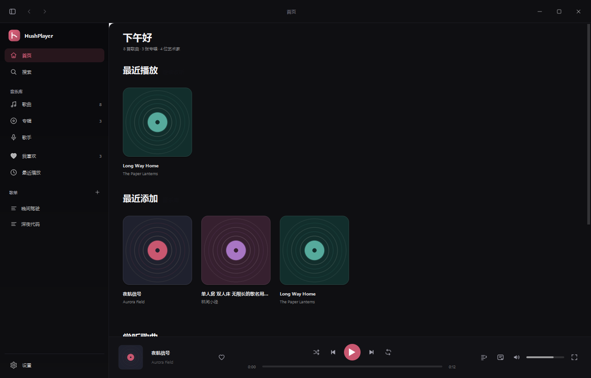
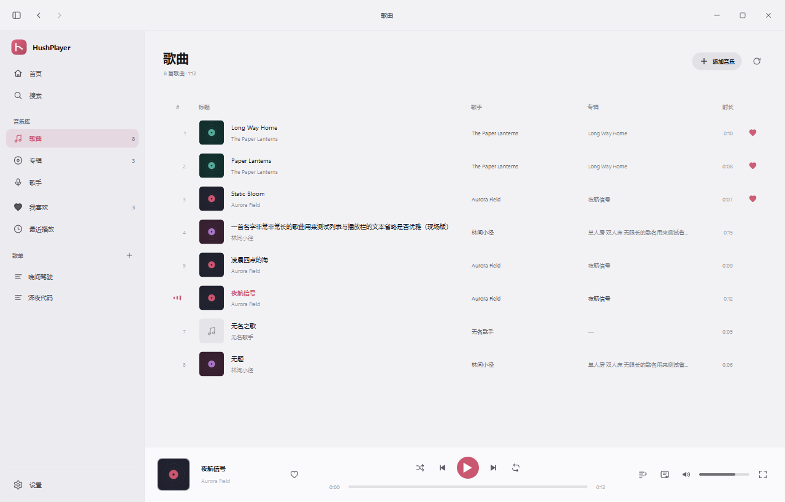
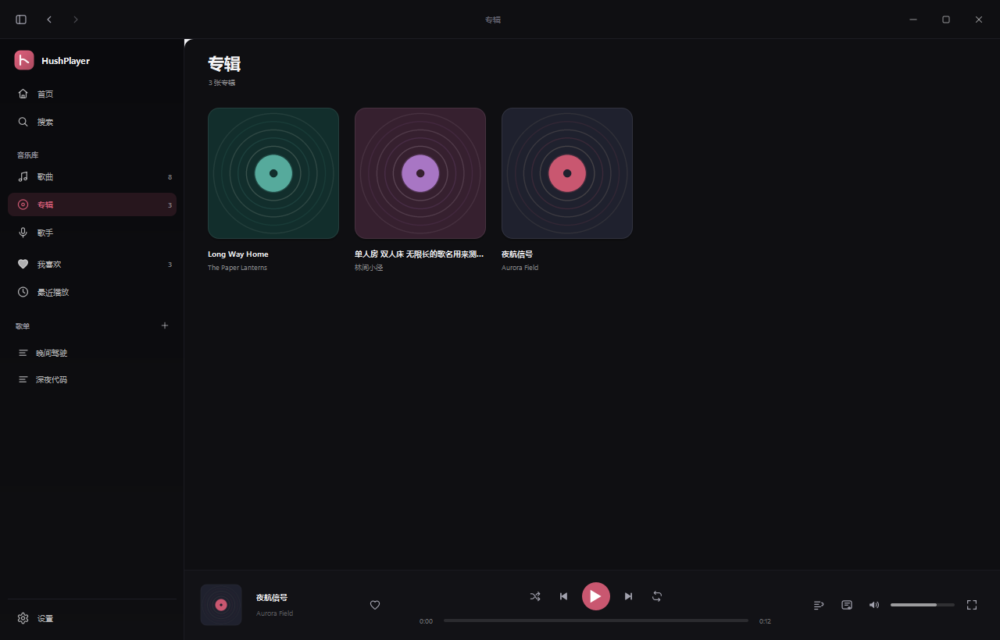
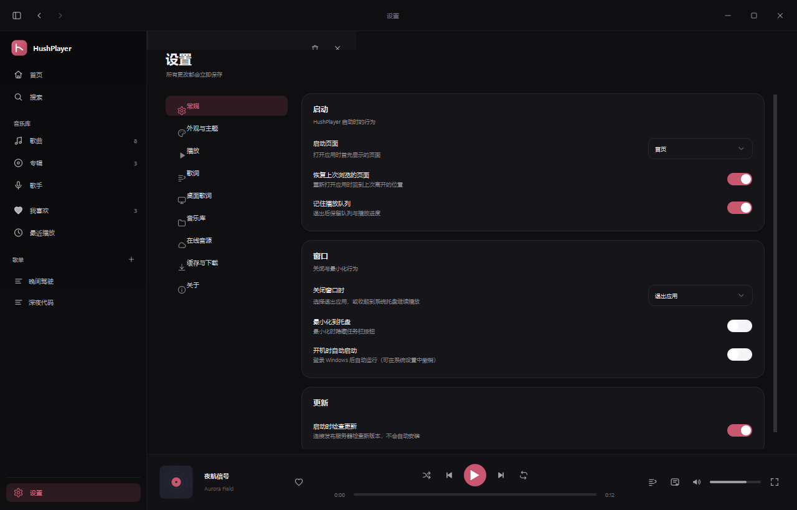
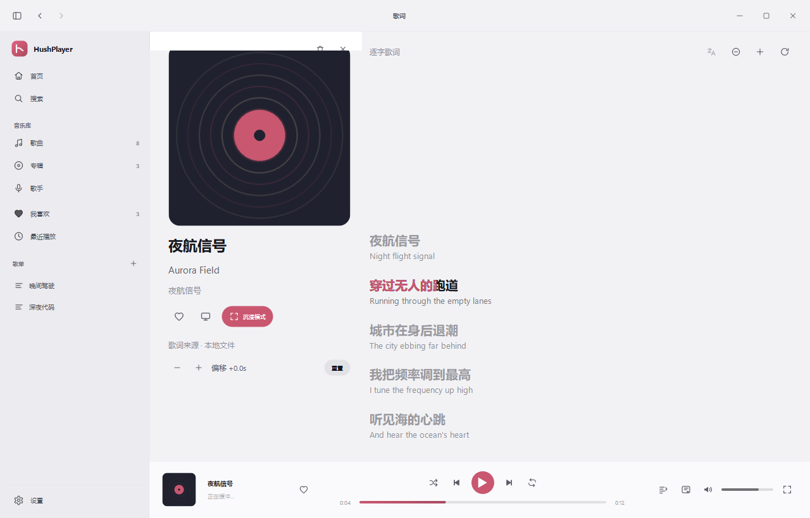
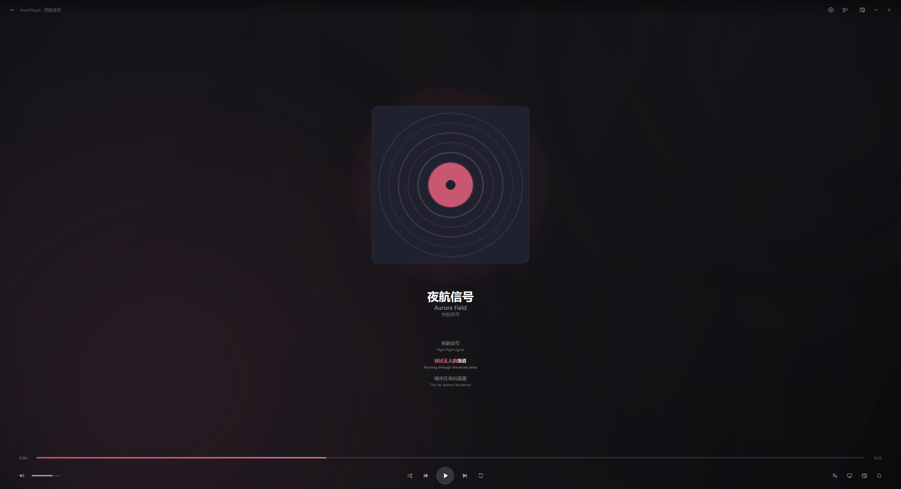
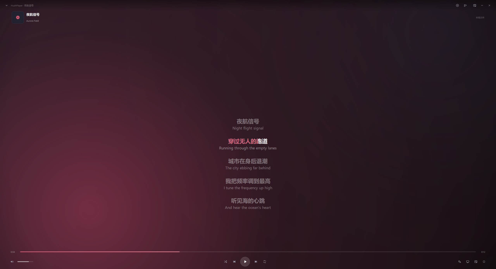

# HushPlayer

一款面向 Windows 10/11 的现代桌面音乐播放器：本地音乐库 + 多平台在线音源 + 完整歌词体验 + 两种沉浸式播放器 + 桌面歌词。

品牌色 `#C95770`（莓果红），界面参考 macOS Apple Music 的构图与克制感，但在 Windows 上使用原生窗口行为，并保留 HushPlayer 自己的视觉身份。



| 歌曲（浅色） | 专辑（深色） | 设置（深色） |
| --- | --- | --- |
|  |  |  |

| 歌词页（浅色） | 沉浸式 · 封面舞台 | 沉浸式 · 全幕歌词 |
| --- | --- | --- |
|  |  |  |

> 所有截图均来自真实运行的程序（`tools/shot_app.py`），不是设计稿。

## 功能

- **本地音乐库**：导入文件/文件夹、递归扫描、MP3/FLAC/WAV/AAC/M4A/OGG 等格式、读写元数据、内嵌与同目录封面、增量扫描（按大小 + 修改时间）、失效文件清理、专辑/歌手/歌曲视图、最近播放、搜索与排序。
- **在线音源**：复用原版 HushPlayer 的 Node.js 音源运行时（MusicFree 兼容插件），统一数据模型，跨音源播放回退，真实搜索/播放/歌词/下载能力按音源实际支持情况展示（见 [docs/FEATURES.md](docs/FEATURES.md)）。
- **播放**：播放/暂停、上一首/下一首、进度拖动、音量与静音、单曲循环/列表循环/顺序播放、随机播放（界面顺序与播放顺序分离，随机序列可预告）、队列增删改与拖拽排序、本地与在线混播、长时间暂停后在线资源自动重新解析。
- **收藏与歌单**：我喜欢、歌单增删改、歌单内排序、批量管理、在线与本地歌曲统一收藏模型。
- **歌词**：本地 `.lrc/.yrc/.qrc/.krc/.txt`、内嵌标签、在线音源歌词、LRCLIB 回退；逐行 / 逐字 / 逐词真实时间轴；双语与翻译显示；偏移校准（±60s）；纯音乐/无歌词状态。
- **沉浸式播放器**：模式 A 全幕歌词、模式 B 封面舞台；封面取色环境光（无实时高斯模糊）；完整播放控制、队列、翻译开关、全屏与快捷键。
- **桌面歌词**：单行/双行、逐字高亮、拖动、置顶、锁定与鼠标穿透、字体/颜色/不透明度、多显示器与 DPI 适配。
- **设置中心**：外观（含主题预览）、播放、歌词、桌面歌词、音乐库目录、在线音源、缓存与下载、启动与窗口行为、更新、关于；修改即时生效并持久化。
- **Windows 集成**：自绘标题栏（原生移动/缩放/贴边、DWM 圆角与暗色边框）、系统托盘、媒体键、单实例（命名互斥体）、高 DPI（Per-Monitor V2）、多显示器位置校正、关闭到托盘/最小化到托盘、崩溃日志与 faulthandler。
- **在线缓存与下载**：本地 HTTP 代理（Range 支持 + 磁盘缓存 + 完整性索引）、缓存统计/清理/修复/容量上限；音源支持时下载到本地并记录索引。

## 快速开始（开发）

```powershell
# 1. 环境（Windows 10/11，Python 3.11+，Node.js 用于在线音源）
python -m venv .venv --system-site-packages
.\.venv\Scripts\python.exe -m pip install -r requirements.txt
.\.venv\Scripts\python.exe -m pip install -r requirements-dev.txt

# 2. 启动
.\.venv\Scripts\python.exe -m hushplayer

# 3. 测试
.\.venv\Scripts\python.exe -m pytest

# 4. 截图（真实窗口，含浅色/深色）
.\.venv\Scripts\python.exe tools\shot_app.py
```

在线音源需要 Node.js（开发态使用系统 `node`；打包版内置 `node.exe`）。音源插件位于 `hushplayer/runtime/source_runtime/`（从原版 HushPlayer 复制，属于用户已安装的第三方插件，说明见 [docs/LICENSES.md](docs/LICENSES.md)）。

## 打包

```powershell
# 完整构建：跑测试 → 取/下载 node.exe → PyInstaller → 可选 zip
powershell -ExecutionPolicy Bypass -File packaging\build.ps1 -Zip
```

产物：

- `packaging/out/HushPlayer/HushPlayer.exe`（onedir，约 245 MB，自带 Node 与音源运行时）
- `packaging/out/HushPlayer-1.0.0-win64.zip` + `SHA256SUMS.txt`（使用 `-Zip` 时）

安装/卸载说明见 [docs/INSTALL.md](docs/INSTALL.md)；更新机制见 [docs/UPDATES.md](docs/UPDATES.md)。

## 数据位置

| 类型 | 位置 |
| --- | --- |
| 用户数据（数据库、歌单、设置、歌词缓存） | `%LOCALAPPDATA%\HushPlayerReimagined` |
| 可重建缓存（音频、封面） | 同上 `cache\` 子目录 |
| 日志 | 同上 `logs\hushplayer.log`（5 MB × 5 轮转）与 `crash.log` |
| 下载 | 默认 `%USERPROFILE%\Music\HushPlayer Downloads`，可在设置中修改 |

便携模式：在 exe 同级放置 `portable.txt`（或设置环境变量 `HUSHPLAYER_PORTABLE=1`），数据会写到 exe 同级 `Data\`。
若首选数据目录不可写，程序会自动退回 exe 同级 `Data\`，再退回临时目录，并在日志中记录。

数据迁移（旧版 HushPlayer → 本版）见 [docs/MIGRATION.md](docs/MIGRATION.md)，工具默认只预览、写入前自动备份。

## 文档

- [功能完成度矩阵](docs/FEATURES.md)
- [架构说明](docs/ARCHITECTURE.md)
- [测试报告](docs/TEST_REPORT.md)
- [截图清单](docs/SCREENSHOTS.md)
- [第三方依赖与许可](docs/LICENSES.md)
- [已知问题](docs/KNOWN_ISSUES.md)
- [安装与卸载](docs/INSTALL.md)
- [更新机制](docs/UPDATES.md)
- [数据迁移](docs/MIGRATION.md)
- [交付总结](docs/DELIVERY.md)
- [开发进度与后续计划](docs/DEV_PROGRESS.md)

## 许可

本项目源码以 MIT 许可发布（见 `LICENSE`）。运行时依赖的第三方组件、Node.js 与音源插件适用其各自许可；本项目不包含任何受 DRM 保护的内容，也不绕过付费/权限限制。
